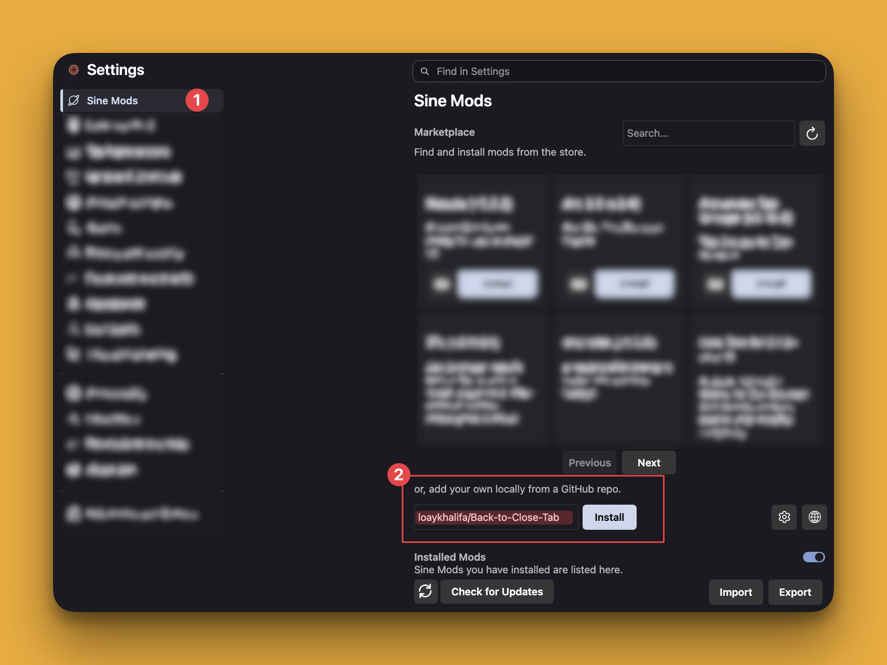

# Back to Close Tab

**Go back when you can. Close the tab when you can’t.**

A browser-interface JavaScript mod for **Zen Browser**. When the selected tab has a previous page, Back works normally. When it has no Back history, the mod closes the **unpinned tab** instead.

**BetterTouchTool is not required.** This version contains no BTT state bridge, BTT URL calls, or macOS subprocess integration.

> [!WARNING]
> Back can close the current tab, including the last unpinned tab in a window. Save important work before testing. Pinned tabs are protected by default.

## Contents

- [Features](#features)
- [How it works](#how-it-works)
- [Requirements](#requirements)
- [Installation](#installation)
- [Usage](#usage)
- [Configuration](#configuration)
- [Troubleshooting](#troubleshooting)
- [Updating and uninstalling](#updating-and-uninstalling)
- [Testing and contributing](#testing-and-contributing)
- [Privacy and security](#privacy-and-security)
- [License](#license)

## Features

- Native Back navigation when history exists.
- Closing of historyless, unpinned tabs.
- Pinned-tab protection enabled by default.
- Page-only gesture interception: checks the actual element under the pointer, not just the page rectangle.
- Gestures over Spaces, sidebars, toolbars, and hit-testable overlays are left to Zen.
- Native swipe gestures are bound to the tab/browser verified at gesture start.
- Wheel gestures are bound to their starting tab and initial history state.
- Cooldown and gesture-reset safeguards reduce duplicate handling.
- No dependency on BetterTouchTool.

## How it works

| Current tab | Result of a handled Back action |
|---|---|
| Has a previous history entry | Zen navigates back normally. |
| Has no previous entry and is unpinned | The tab closes. |
| Has no previous entry and is pinned | The mod does not close it with default settings. |
| Navigation state cannot be read safely | The mod does not close it based on that unknown state. |

“Back history” means the current tab’s **session navigation history**, not the browser’s overall browsing-history database.

~~~text
Open Page A in an unpinned tab
              ↓
Follow a link to Page B in the same tab
              ↓
Back → return to Page A normally
              ↓
Wait briefly, then Back again → close the tab
~~~

### How page-only gesture checks work

For a swipe to close a tab, the script checks that the browser window is focused, the pointer is inside the selected browser’s visible rectangle, and the topmost hit-tested element is that selected browser.

A native closing swipe additionally requires a verified start, the same selected tab/browser at completion, another successful page hit test, and completion within two seconds.

The wheel fallback ignores a burst that begins over browser UI or later encounters a rejected event. It also checks the initial history state so a native Back action is not immediately followed by a Close from the same wheel burst.

If hit testing is unavailable or ambiguous, the gesture is ignored rather than guessed. These checks are for gestures; explicit keyboard and toolbar Back actions do not require the pointer to be over the page.

## Requirements

- **Zen Browser**
- A working privileged browser-interface JavaScript loader, such as a compatible **[Sine](https://github.com/CosmoCreeper/Sine)** installation and bootloader
- A full browser restart after installation or script changes

This is a **userChrome-style JavaScript script**, not a normal browser extension, website userscript, or CSS theme. A website userscript manager cannot provide the browser APIs it needs.

Zen is the intended browser. No minimum Zen/Sine version is currently specified, and stock Firefox or other forks are not verified. Removing the macOS-specific BTT bridge does not by itself establish compatibility with every operating system or trackpad.

## Installation

### 1. Back up your profile or existing mod

In Zen, open **about:support**, locate **Profile Folder**, and open it in your file manager.

Quit Zen before copying the profile or installed mod folder to a safe backup location. Keep backup scripts **outside active loader/mod directories** to avoid accidental duplicate loading.

### 2. Install Sine

Follow the current upstream instructions:

- [Sine repository](https://github.com/CosmoCreeper/Sine)
- [Installation guide](https://github.com/sineorg/docs/blob/main/src/installation.md)
- [Installer releases](https://github.com/CosmoCreeper/Sine/releases)

Choose the installer appropriate for your operating system and CPU, follow its instructions, and restart Zen. Confirm that Sine appears in Settings for the profile you actually use.

### 3. Add this repository

1. Open **Zen Settings → Sine**.
2. Find the option to install a mod from a GitHub repository.
3. Enter:

   ~~~text
   loaykhalifa/Back-to-Close-Tab
   ~~~

4. Follow the prompts and enable the mod.
5. Fully quit and reopen Zen.

The exact interface labels can vary between Sine versions.

> [!NOTE]
> This repository contains a standalone script without a separate Sine mod manifest. If your Sine version rejects the repository or does not load its JavaScript, installation is not complete. A visible mod entry alone does not prove the script ran.

### Alternative: an existing compatible loader

Install [backbutton-close-tab.uc.js](./backbutton-close-tab.uc.js) using your privileged loader’s documented script directory and restart/cache procedure.

If replacing an existing installation, back it up first and replace its active script rather than adding a second copy.

Do not paste JavaScript into userChrome.css. Simply placing the file in a profile folder or enabling CSS customization does not load JavaScript.

### 4. Verify installation

Use disposable, unpinned tabs without unsaved work:

1. Open a website directly in a fresh tab.
2. Press **Alt + Left Arrow**. It should close if the tab has no Back history.
3. In another tab, follow a link to a second page and go Back. It should navigate normally.
4. Test gestures over the page and over Spaces separately.

For advanced verification, inspect Zen’s **Browser Console**, not a website’s Developer Console. Look for a startup message beginning with:

~~~text
[backbuttonCloseTabController] Loaded
~~~

## Usage

### Handled inputs

| Input | Details |
|---|---|
| Alt + Left Arrow | Explicit keyboard handler; Ctrl, Command/Meta, and Shift must not also be held. |
| BrowserBack key | Keyboard events whose key value is BrowserBack. |
| Toolbar Back button | Pointer/click handlers, including an attempt to handle a visually disabled Back button. |
| Browser Back commands | Browser:Back and Browser:BackOrBackDuplicate command events. |
| Native swipe | Browser left-direction native swipe events, with verified page start and completion. |
| Horizontal wheel/trackpad movement | Distance-based fallback over the selected page. |

Other shortcuts may work if Zen routes them through a handled command, but they are not all explicitly recognized. **Command + [ is not explicitly matched by the keyboard handler.** Mouse side-button compatibility is not guaranteed.

### Trackpad gestures

Keep the pointer over the actual **web page**, not Spaces or the sidebar. Perform your normal Back gesture.

The wheel fallback requires mostly horizontal movement and a default accumulated distance of **140 normalized pixels**. Native swipe direction uses the browser’s event constant and may not directly describe the physical direction of your fingers.

Wait about a second between deliberate tests. Do not test with unsaved work.

> [!CAUTION]
> Sufficiently horizontal scrolling on a historyless page can be interpreted as Back intent. Disable the mod if this conflicts with your use of horizontally scrolling pages.

### Pinned tabs and recovery

Pinned tabs stay protected by default.

If you close a tab accidentally, use Zen’s **Reopen Closed Tab** command when available. Restoring a tab does not guarantee recovery of unsaved input. Closing the final tab can close the window depending on Zen’s settings.

## Configuration

Edit the CONFIG object near the top of the script, preserve valid JavaScript syntax, and restart Zen. There is no settings UI supplied by this script.

| Setting | Default | Purpose |
|---|---|---|
| SWIPE_THRESHOLD_PX | 140 | Required accumulated Back-direction distance for the wheel fallback. |
| GESTURE_RESET_MS | 500 | Idle interval in milliseconds before wheel state resets. |
| ACTION_COOLDOWN_MS | 900 | Cooldown in milliseconds used to reduce duplicate closing actions. |
| HORIZONTAL_DOMINANCE_RATIO | 1.25 | Required horizontal-to-vertical distance ratio for the wheel fallback. |
| BACK_SWIPE_DIRECTION | "left" | Wheel fallback uses negative horizontal deltas; "right" uses positive deltas. |
| CLOSE_PINNED_TABS | false | Protect pinned tabs. Set true only if you intentionally want to allow closing them. |
| DEBUG | false | Enable additional diagnostic logging. |

BACK_SWIPE_DIRECTION and the distance threshold affect the **wheel fallback only**. Native swipe recognition remains tied to DIRECTION_LEFT.

Local changes may be overwritten by mod updates.

## Troubleshooting

### Sine is missing or installation fails

Check the official Sine installation instructions, correct profile, bootloader, and error messages. Fully restart Zen. Clear the startup cache through about:support only if your loader’s instructions require it.

Standalone-script handling depends on your Sine version because this repository has no separate mod manifest.

### Back does nothing

- Confirm the script’s startup message appears.
- Check whether the tab is pinned.
- Test Alt + Left Arrow before troubleshooting gestures.
- Wait at least a second between attempts.
- Temporarily disable conflicting navigation/gesture mods.
- Ensure the pointer is over the page for gesture tests.
- An ambiguous hit test deliberately prevents closing.
- Some synthetic events are ignored.

### Back navigates instead of closing

This is expected if the tab has a previous session-history entry.

### A swipe over Spaces does not close a tab

This is intentional. The mod should leave those gestures to Zen.

### Swipes trigger too easily or not easily enough

Adjust SWIPE_THRESHOLD_PX or HORIZONTAL_DOMINANCE_RATIO for the wheel fallback. Try BACK_SWIPE_DIRECTION: "right" if wheel deltas are reversed.

These settings do not change native swipe recognition.

### Zen crashes or behaves unexpectedly

Stop testing with important tabs. Disable the mod and restart Zen. Restore your backup if needed.

Report the exact pointer location, gesture, browser version, tab state, and other mods involved. The stricter checks address unwanted interception, but they are not a guarantee against all browser crashes.

### The last tab closes the window

There is deliberately no last-tab guard. Zen determines the outcome after the final unpinned tab is removed.

## Updating and uninstalling

### Update

Use your Sine version’s update controls, or replace the script according to your loader’s instructions. Back up customizations first, then restart Zen.

Re-test history navigation, historyless closing, pinned protection, and Spaces gestures after updates.

### Disable or remove

In Sine, disable/remove the mod and fully restart Zen. With another loader, follow that loader’s removal procedure.

If you used an older BTT-integrated version, its BTT conditions or stored variables are not removed automatically. This version does not read or update them.

## Testing and contributing

The maintainer reported that the stricter page-only version appeared to work in an initial local Zen test. This is not comprehensive compatibility testing or proof that every crash is fixed.

The repository includes mocked regression tests:

~~~sh
node tests/gesture-safety.test.cjs
~~~

Use Node.js 18 or newer for the development tests. **Node is not needed to use the mod in Zen.** The tests use only built-in modules and do not launch Zen.

Mock tests check gesture ownership, page/UI rejection, tab changes, history state, pinned tabs, and duplicate events. They cannot establish actual native event delivery or browser stability.

For manual testing, use disposable tabs and verify:

- Normal Back navigation and historyless closing
- Pinned protection and final-tab behavior
- Page gestures versus Spaces/sidebar/toolbar gestures
- Horizontal and vertical scrolling
- Rapid/duplicate gestures and tab changes during gestures
- Disabling the mod and restarting

[Open an issue](https://github.com/loaykhalifa/Back-to-Close-Tab/issues) with your OS, Zen version, loader versions, input method, pointer location, pinned/history state, reproduction steps, and relevant Browser Console messages. Remove private information from logs.

Discuss substantial changes first. Document your actual test environment and results.

## Privacy and security

The runtime script reads local browser navigation state and pointer hit-test results. It contains no BTT integration, telemetry, remote requests, or subprocess calls.

Privileged browser scripts can access sensitive browser functionality. Review the script and updates before installing, and keep a profile backup.

Review repository automation separately. Do not enable or run unreviewed workflows or encoded shell payloads.

## License

No LICENSE file is currently supplied. Public visibility alone does not grant an open-source license. Ask the maintainer about reuse and distribution terms.
